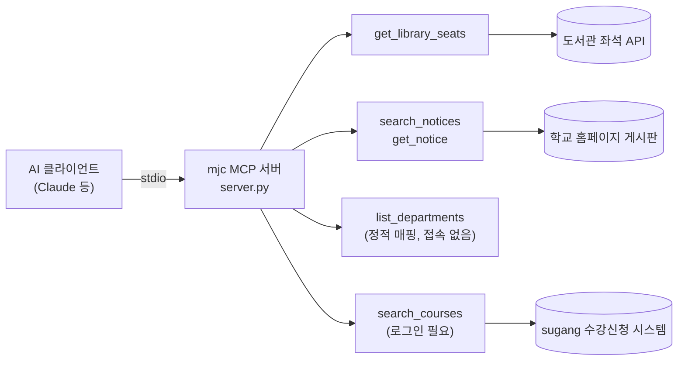

# 명지전문대 MCP 서버

**AI 에이전트가 명지전문대 학교 데이터를 직접 조회할 수 있게 해주는 어댑터입니다.**

"지금 도서관에 자리가 있는지", "이번 주 장학 공지가 무엇인지", "다음 학기 전공 강좌가 무엇인지"를
확인하려면 도서관 좌석 현황판·학교 홈페이지 게시판·수강신청 시스템을 각각 따로 방문해야
합니다. 각 시스템은 개별적으로는 잘 동작하지만, 서로 연결되어 있지 않고 AI 에이전트가 읽을
수 있는 형태로도 제공되지 않습니다.

그래서 학교 전용 챗봇 UI를 새로 만드는 대신, AI 에이전트가 이 데이터에 직접 접근할 수 있게
하는 어댑터를 만들었습니다. 학교가 자체 챗봇을 만들면 그 챗봇 안에서만 쓸 수 있지만,
MCP(Model Context Protocol)는 **규격**이라 Claude든 앞으로 나올 다른 AI 클라이언트든
설정 몇 줄만 추가하면 그대로 붙습니다. 우리가 미리 만들어두지 않은 질문에도
AI가 툴을 스스로 조합해 답합니다.

---

## 동작 방식



---

## 30초 설치

```bash
git clone https://github.com/4thIS/hachathon_mjc_mcp.git
cd hachathon_mjc_mcp
python -m venv .venv
.venv/Scripts/python -m pip install -r requirements.txt
```

AI 클라이언트 설정(`.mcp.json` 등)에 아래를 추가하고 클라이언트를 재시작합니다.
경로는 clone한 위치에 맞게 바꿔주세요.

```json
{
  "mcpServers": {
    "mjc": {
      "type": "stdio",
      "command": "C:\\경로\\hachathon_mjc_mcp\\.venv\\Scripts\\python.exe",
      "args": ["C:\\경로\\hachathon_mjc_mcp\\server.py"]
    }
  }
}
```

끝입니다. 도서관 좌석·공지·학과 목록 조회는 별도 계정이나 API 키가 필요 없습니다.
강좌 검색(`search_courses`)과 강의계획서 조회(`get_syllabus`)만 본인 학교 계정
로그인이 필요합니다 — 아래 "로그인이 필요한 툴 사용법" 참고.

> 요구 사항: Python 3.10 이상 (`mcp` SDK 요구 사항 기준. 개발·검증 환경은 3.14).
> macOS/Linux는 `command`를 `.venv/bin/python`으로 바꿉니다.

---

## 이렇게 물어보세요

**한 번에 답이 나오는 질문**

- "지금 도서관 어디가 제일 한산해?"
- "이번 주 학사공지 알려줘"
- "장학 공지 뭐 올라왔어?"
- "채용공지 최근 5개만 보여줘"
- "학교 일반 공지사항 뭐 있어?"

**AI가 툴을 엮어야 답이 나오는 질문** — 이게 이 프로젝트의 핵심입니다

- "방학 중에 학교 식당 언제 열어?"
  → `search_notices`로 공지 목록을 받고, AI가 제목에서 해당 공지를 골라
  `get_notice`로 본문까지 이어서 조회합니다. 운영 기간·시간·영업 매장이 본문에
  들어 있어 AI가 정리해서 답합니다.

  ```mermaid
  sequenceDiagram
      participant U as 사용자
      participant AI as AI 클라이언트
      participant M as mjc MCP 서버

      U->>AI: 방학 중에 학교 식당 언제 열어?
      AI->>M: search_notices(category="general")
      M-->>AI: 공지 제목·날짜 목록
      AI->>AI: 관련 공지 선택
      AI->>M: get_notice(notice_id)
      M-->>AI: 본문(운영 기간·시간·매장)
      AI-->>U: 정리해서 답변
  ```
- "지금 학교 가려는데, 도서관 자리 있고 밥 먹을 데 있어?"
  → 좌석 조회와 공지 조회가 함께 필요한, 우리가 미리 설계하지 않은 흐름입니다.
  툴 3개가 모두 호출됩니다.
- "채용공지 중에 이번 주 마감인 거 있어?"
  → 목록의 제목·날짜를 훑고 필요하면 본문까지 확인합니다.
- "정보통신공학과 3학년 전공 수업 뭐 있어?"
  → `list_departments`로 학과명을 코드로 바꾸고, 그 코드로 `search_courses`를
  호출합니다. 학과 내부 코드를 AI에게 미리 알려줄 필요가 없습니다(로그인 필요,
  아래 참고).
- "정보통신공학과 3학년 캡스톤디자인 강의계획서 보여줘"
  → list_departments로 학과 코드를, search_courses로 과목의 course_code/section을
  얻은 뒤 get_syllabus로 강의계획서를 조회하는 3단계 조합입니다.

---

## 제공하는 툴

| 툴 | 하는 일 | 주요 인자 | 데이터 출처 |
|---|---|---|---|
| `get_library_seats` | 열람실 3곳(집중학습공간·개방형학습공간·미디어실) 실시간 좌석 현황 | 없음 | 도서관 좌석 시스템 |
| `search_notices` | 공지 게시판 최신 글 목록 | `category`: `general`·`academic`·`scholarship`·`job` / `limit` | www.mjc.ac.kr 게시판 |
| `get_notice` | 공지 한 건의 본문, 첨부파일 목록, 본문 이미지 링크, 원문 페이지 주소 | `notice_id` (목록이 돌려준 값 그대로) | www.mjc.ac.kr 게시판 |
| `list_departments` | 학과 목록(이름·코드). 로그인 불필요 | 없음 | sugang(정적 매핑) |
| `search_courses` | 개설 강좌 검색. **로그인 필요** — 아래 참고 | `department_code`(목록이 돌려준 값), `course_type`, `grade`, `keyword` | sugang 수강신청 시스템 |
| `get_syllabus` | 강의계획서 조회(NCSI 연동). **로그인 필요** | `department_code`(list_departments가 준 값 — search_courses 호출에 쓴 것과 동일한 값), `course_code`·`section`(search_courses 결과 값) | ncsi.mjc.ac.kr |

모든 툴은 **읽기 전용**입니다(`read_only_hint=True`). 학교 시스템에 무언가를
쓰거나 바꾸는 동작은 없습니다.

### 로그인이 필요한 툴 사용법 (`search_courses`, `get_syllabus`)

비밀번호를 저장하지 않으므로, 세션이 없거나 만료되면 별도 터미널에서 직접 로그인해야 합니다.

```bash
.venv/Scripts/python auth/login_helper.py sugang
```

학번·비밀번호를 입력하면(화면에 표시되지 않음) 세션만 로컬(`%LOCALAPPDATA%\mjc-mcp\`, 저장소 밖)에 저장합니다.
비밀번호는 어디에도 저장하지 않으므로, 교내 SSO 비밀번호가 90일마다 강제로 바뀌어도
다음에 헬퍼를 다시 실행할 때 그 시점의 비밀번호를 입력하면 됩니다. 세션이 만료되면
두 툴 모두 자동으로 재로그인을 시도하지 않고 "헬퍼를 실행하세요"라는
안내만 돌려줍니다.

`get_syllabus`는 sugang 로그인 세션을 그대로 재사용합니다 — NCSI(강의계획서
시스템)용으로 별도 로그인을 요구하지 않습니다.

설계 의도 — 왜 목록과 상세를 나눴는지, 왜 게시판 내부 코드를 AI에게 숨기는지,
데모 중 서버가 죽어도 답이 나오게 한 캐시 폴백 구조 등 — 은
**[docs/design.md](docs/design.md)** 에 정리했습니다.

---

## 데이터 수집 원칙

- 대부분의 툴은 로그인 없이 누구나 볼 수 있는 **공개 페이지만** 조회합니다.
  `search_courses`와 `get_syllabus`만 예외로, 사용자 본인 계정 로그인이
  필요합니다(아래 참고).
- `robots.txt`를 확인했습니다. `www.mjc.ac.kr`은 `User-agent: * / Allow: /`로
  전면 허용(2026-08-06). `sugang.mjc.ac.kr`은 `robots.txt` 자체가 없습니다(2026-08-07,
  명시적 허용도 거부도 아닌 상태).
- 동일 호스트에 대한 연속 요청 사이에 **최소 1초 간격**을 둡니다. 사람이 브라우저로
  접근하는 것보다 높은 빈도로 호출하지 않습니다.
- 프로젝트를 식별할 수 있는 User-Agent(`MJC-MCP/0.1 (+저장소 주소)`)를 보냅니다.
- 조회 결과는 사용자의 AI 클라이언트에만 전달됩니다. **외부로 전송하거나
  재배포하지 않습니다.** 로컬 캐시는 데모 중 장애 대비용이며 저장소에 포함되지 않습니다.
- 이 저장소에는 계정·비밀번호·세션 등 어떤 자격증명도 포함되어 있지 않습니다.
- `search_courses`·`get_syllabus`(로그인 필요)는 사용자 본인 계정으로만 동작하며,
  비밀번호는 디스크에 저장하지 않고 세션 쿠키만 저장소 바깥에 저장합니다. 자동
  재로그인은 하지 않습니다.
- 실제 서비스로 운영하려면 **학사팀 협의가 전제**입니다.

---

## 한계 (정직하게)

- **게시판 페이지네이션을 지원하지 않습니다.** 각 게시판의 첫 페이지 범위 안에서만
  조회됩니다. 오래된 공지는 찾지 못합니다.
- **본문이 이미지로 작성된 공지는 텍스트를 추출할 수 없습니다.** 이 경우 그 사실을
  명시하는 안내 문구와 함께 본문 이미지 링크(`body_images`), 원문 페이지 주소
  (`source_url`), 첨부파일 목록을 돌려줍니다. 없는 내용을 지어내지 않고 사람이
  직접 보게 넘기는 것이 목적입니다.
- **본문이 4000자를 넘으면 잘립니다.** 잘린 경우 응답의 `truncated` 필드로 그 사실을
  알려, AI가 잘린 내용을 전체인 것처럼 인용하지 않도록 합니다.
- **학교 사이트 구조가 바뀌면 파싱이 깨집니다.** 다만 파싱 계층을 분리해 두어
  해당 툴 파일 하나만 고치면 되도록 설계했습니다.
- **`search_courses`는 실시간 신청 인원을 제공하지 않습니다.** sugang 자체가
  이 값을 목록 응답에 포함하지 않고 별도 새로고침을 요구합니다 — 정원(`capacity`)까지만
  제공합니다.
- **`search_courses`는 사용자가 별도 터미널에서 로그인 헬퍼를 먼저 실행해야
  동작합니다.** 세션이 만료되면 자동으로 재로그인하지 않고 안내 메시지만 돌려줍니다.
- **`get_syllabus`는 핵심 필드만 구조화합니다.** 주차별(15주) 상세 계획, 교재,
  장애학생 학습지원 안내, 담당교수 연락처는 담지 않습니다 — 응답의 source_url에서
  원문을 직접 확인하세요.
- **추가 시스템 연동은 보류했습니다.** E-class(`cyber.mjc.ac.kr`)는 `robots.txt`가 전면
  크롤링을 거부하고 있어 진행하지 않았습니다. 커리어정보 시스템(`mpu.mjc.ac.kr`)은 조사
  결과 E-class 안에 내장되는 제3자 벤더 시스템으로 확인되어 함께 보류했습니다. 자격증명
  취급 원칙은 [docs/design.md](docs/design.md) 8장에 정리했습니다.
- 도서관 좌석 API는 비표준 포트를 쓰기 때문에 일부 제한된 네트워크(게스트 Wi-Fi 등)
  에서는 도달하지 못할 수 있습니다.

---

## 개발

```bash
.venv/Scripts/python -m pytest tests/ -v
```

파서 테스트는 실제 응답을 **bytes 원본**으로 저장한 fixture를 사용합니다.
텍스트로 저장하면 인코딩 버그를 감추기 때문입니다.

```
server.py        진입점. 각 툴 모듈의 register(mcp) 호출만 한다
common/          http · parse · cache · errors · models · session (공통 레이어)
auth/            login_helper.py — 독립 CLI, 사용자가 직접 실행
tools/           library_seats.py, notices.py, departments.py, course_search.py, syllabus.py
tests/fixtures/  실제 응답 원본
docs/design.md   설계 문서
```

---

## 팀

| GitHub | 역할 |
|---|---|
| [@Hyeon02-kr](https://github.com/Hyeon02-kr) | 팀장 · 공통 레이어 · 로그인 인프라 · 서버 통합 |
| [@ghl0801](https://github.com/ghl0801) | 도서관 좌석 툴 · 학과 목록 툴 |
| [@mnzsuu](https://github.com/mnzsuu) | 공지 게시판 툴 · 강좌 검색 툴 |

2026년 명지전문대 캡스톤 경진대회 출품작.

---

## 라이선스

[MIT](LICENSE)
